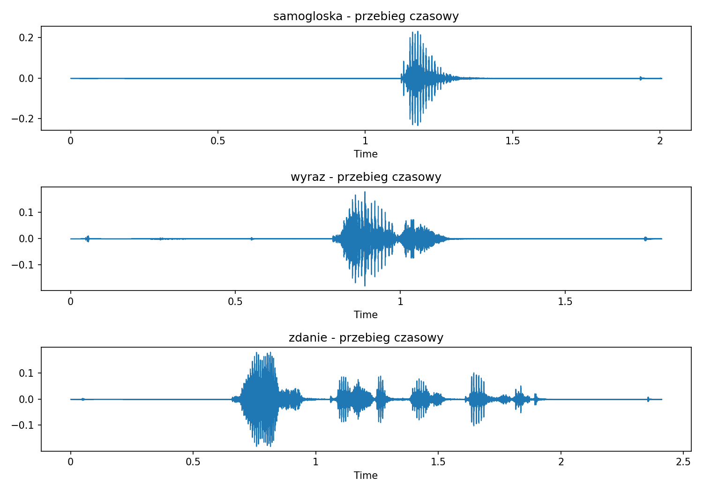
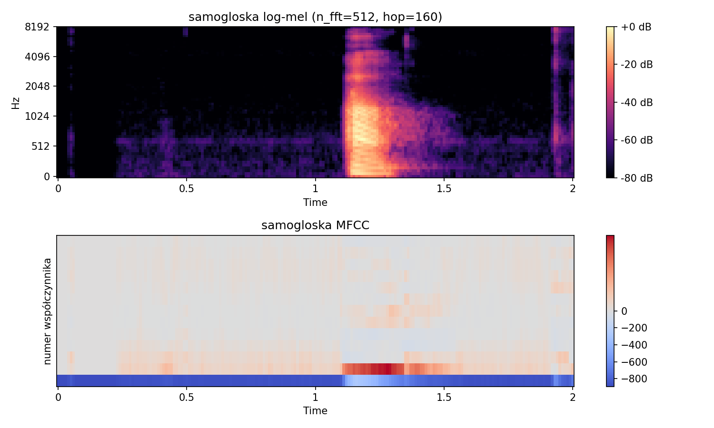
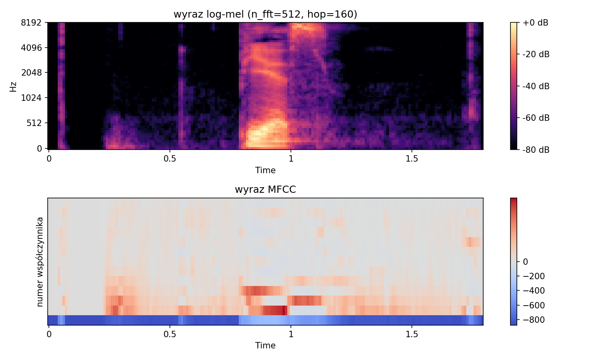
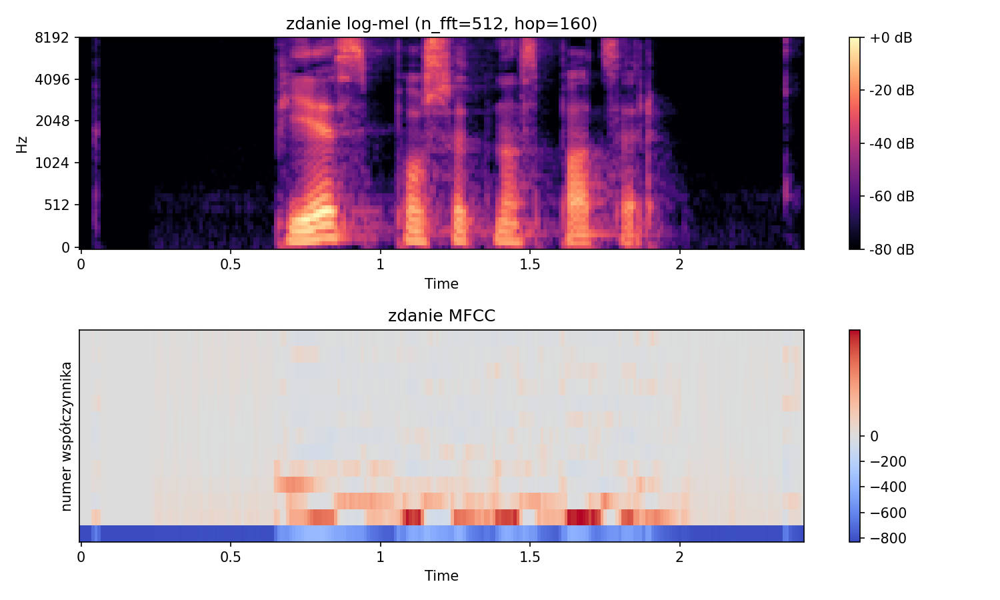
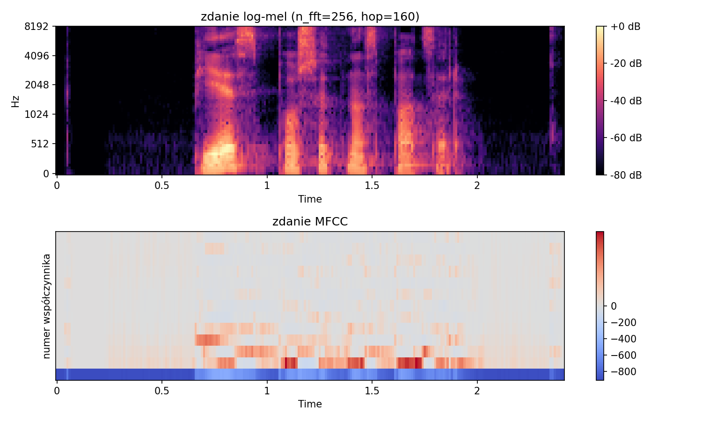

# Sprawozdanie laboratoryjne

**Przedmiot:** Uczenie głębokie w systemach rozpoznawania i przetwarzania mowy
**Zajęcia nr / temat:** 1 — Sekwencje i sygnał mowy: od fali dźwiękowej do reprezentacji
**Autor / grupa:** Jakub Powroźnik, Gr 03
**Data:** 21.10.2026

## 1. Cel ćwiczenia

Wygenerowanie i porównanie przebiegu czasowego, log-mel i MFCC dla trzech własnych nagrań (samogłoska „a", wyraz „pies", zdanie „pies poszedł na spacer") oraz zbadanie wpływu `n_fft` i `hop_length` na spektrogram.

## 2. Metoda i implementacja

Użyłem bibliotek librosa, numpy i matplotlib (Jupyter w VS Code). Kod jest w notatniku `cwiczenie.ipynb` w repozytorium, razem z nagraniami (`a.wav`, `Wyraz.wav`, `Zdanie.wav`) i wykresami. Nagrania zrobiłem dyktafonem w telefonie i wczytałem przez `librosa.load(sr=16000, mono=True)` bez przycinania, więc na brzegach jest cisza i kliknięcia dyktafonu.

Konfiguracja bazowa (baseline): `n_fft = 512` (32 ms), `hop_length = 160` (10 ms), 64 pasma mel, 13 MFCC. Log-mel to `melspectrogram` + `power_to_db(ref=np.max)` ze stałą skalą barw −80…0 dB. MFCC liczę bezpośrednio z sygnału, więc librosa używa domyślnie 128 pasm mel i innej referencji dB, przez co wartości nie są wprost porównywalne z log-mel.

```python
S = librosa.feature.melspectrogram(y=y, sr=sr, n_fft=n_fft, hop_length=hop, n_mels=64)
S_db = librosa.power_to_db(S, ref=np.max)
M = librosa.feature.mfcc(y=y, sr=sr, n_mfcc=13, n_fft=n_fft, hop_length=hop)
```

## 3. Wyniki

| Nagranie   | Czas [s] | Próbek | Log-mel   | MFCC      |
|------------|----------|--------|-----------|-----------|
| samogłoska | 2,01     | 32 086 | (64, 201) | (13, 201) |
| wyraz      | 1,79     | 28 672 | (64, 180) | (13, 180) |
| zdanie     | 2,41     | 38 571 | (64, 242) | (13, 242) |

Liczba ramek zgadza się ze wzorem `T = 1 + ⌊N / hop_length⌋`.






**Eksperyment A: okno** (zdanie, `hop = 160`, baseline 512) i **B: krok** (zdanie, `n_fft = 512`, baseline 160):

| n_fft | Okno  | Δf       |   | hop | Krok  | Ramek |
|-------|-------|----------|---|-----|-------|-------|
| 256   | 16 ms | 62,5 Hz  |   | 80  | 5 ms  | 483   |
| 512   | 32 ms | 31,25 Hz |   | 160 | 10 ms | 242   |
| 1024  | 64 ms | 15,6 Hz  |   | 320 | 20 ms | 121   |




## 4. Analiza i interpretacja

**Nagrania.** Przebieg czasowy pokazuje, kiedy sygnał jest silny, ale nie co zostało powiedziane. W samogłosce „a" na log-mel widać atak ok. 1,12 s (energia do ok. 8 kHz), a potem do ok. 1,3 s poziome prążki harmonicznych poniżej ok. 1 kHz, na MFCC w tym czasie wyróżnia się współczynnik 1. W wyrazie „pies" ok. 0,80–0,98 s widać energię poniżej ok. 700 Hz i ruchome formanty 1–4 kHz (samogłoska), a ok. 1,00–1,15 s plamę szumu powyżej ok. 4 kHz bez harmonicznych, czyli „s". W zdaniu (mowa ok. 0,65–1,9 s) są kolejne grupy energii przedzielone ciemnymi przerwami, np. ok. 1,05 s. Na MFCC wzorzec zmienia się co ok. 0,1 s i nie da się go odczytać wzrokowo, a log-mel nadal pokazuje pauzy i szum.

**Eksperyment A.** Zakładałem, że dłuższe okno rozmyje szybkie zmiany i wyostrzy harmoniczne. Dla `n_fft = 256` początek mowy ok. 0,65 s jest ostry, ale harmoniczne zlane. Dla 1024 poniżej ok. 1 kHz widać osobne prążki (ok. 0,7–0,9 s), ale początek mowy i kliknięcie ok. 0,05 s są rozmyte. Hipoteza się potwierdziła (kompromis czas ↔ częstotliwość).

**Eksperyment B.** Zakładałem, że zmieni się tylko liczba ramek. Maleje ona odwrotnie proporcjonalnie do kroku (483, 242, 121), a przy `hop = 320` widać „klocki" w czasie. Rozstaw harmonicznych się nie zmienia, bo okno nadal ma 32 ms, więc mniejszy krok nie poprawia rozdzielczości częstotliwościowej.

**Ograniczenia.** Samogłoska jest krótka (ok. 0,2 s dźwięku), więc eksperymenty zrobiłem na zdaniu. Dla `n_fft = 256` librosa zgłosiła puste filtry mel (siatka 62,5 Hz rzadsza niż najwęższe filtry), więc niskich pasm nie porównuję z 512 i 1024. Czasy odczytałem z wykresów na oko (ok. 0,05 s), a nagrania są po jednym na typ.

## 5. Wnioski

1. Przebieg pokazuje kiedy jest dźwięk, a log-mel jaki: harmoniczne w „a", formanty i szum „s" w „pies".
2. W zdaniu log-mel nadal pozwala wskazać pauzy i grupy głosek, a MFCC przestaje być czytelne wzrokowo.
3. `n_fft` to kompromis czas ↔ częstotliwość, a `hop_length` zmienia tylko liczbę ramek.

**Kierunek Poprawy** Poprawiłbym ćwiczenie, nagrywając dłuższą i równą samogłoskę, przycinając ciszę i licząc MFCC z tego samego log-mel (64 pasma).
