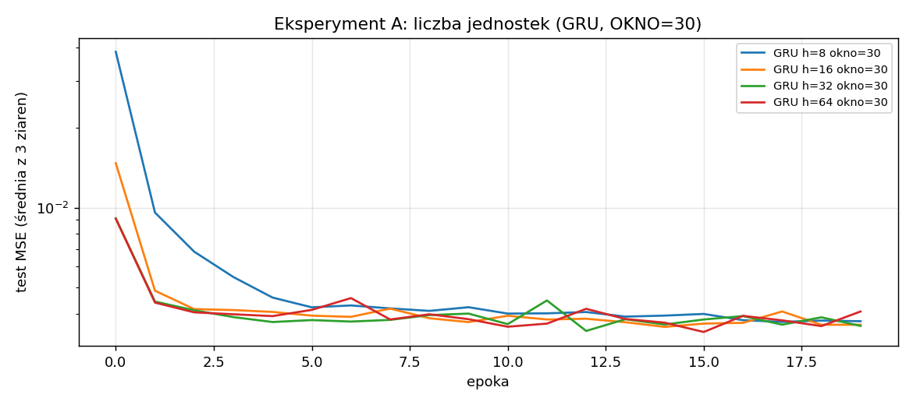
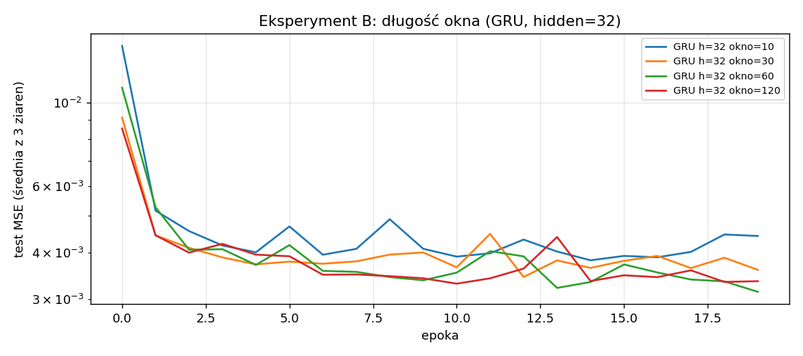
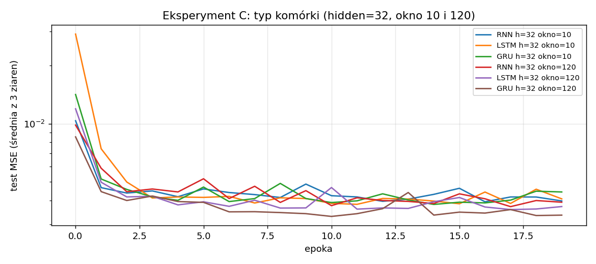
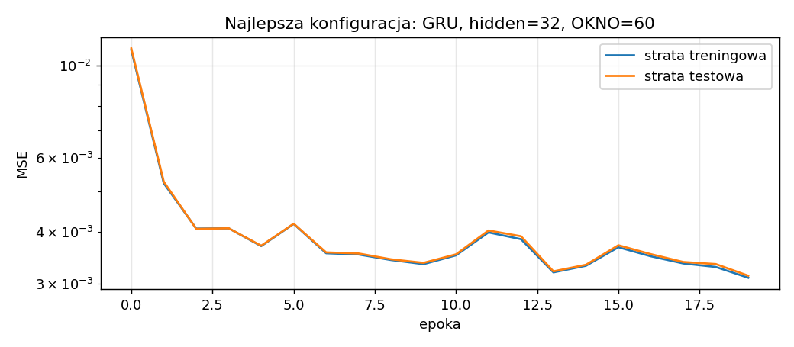
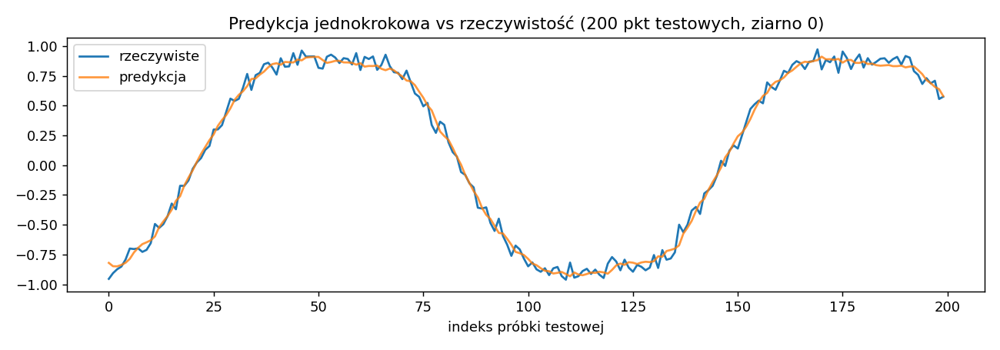

# Sprawozdanie laboratoryjne

**Przedmiot:** Uczenie głębokie w systemach rozpoznawania i przetwarzania mowy
**Zajęcia nr / temat:** 2 — Sieci rekurencyjne: budowa i uczenie
**Autor / grupa:** Jakub Powroźnik Gr 03
**Data:** 22.10.2026

## 1. Cel ćwiczenia

Sprawdzenie, jak liczba jednostek ukrytych (`hidden`), długość okna (`OKNO`) i typ komórki (RNN, LSTM, GRU) wpływają na jakość prognozy kolejnej próbki szeregu czasowego (suma dwóch sinusoid z szumem, σ = 0,05).

## 2. Metoda i implementacja

**Narzędzia:** Python, PyTorch, NumPy, Matplotlib. Kod: `lab2_JP.ipynb` (wyniki z tabel da się odtworzyć uruchomieniem notatnika).

**Dane:** 2000 próbek `sin(t) + 0,1·sin(3t) + szum`, ziarno 0. Okna → następna próbka (many-to-one), podział chronologiczny 80/20; okna tworzone od nowa dla każdego `OKNO`.

**Model:** jedna warstwa rekurencyjna + `nn.Linear(hidden, 1)` na ostatnim stanie ukrytym.

**Trening:** Adam, MSE, 20 epok, lr = 1e-2, batch = 64, clipping 5,0. W `trenuj` dodano zapis straty treningowej.

**Protokół:** 3 ziarna (0, 1, 2), wynik = `np.mean(hist[-5:])`, w tabelach średnia ± odchylenie. Zmienia się jeden czynnik naraz.

**Eksperymenty:** A — GRU, OKNO = 30, hidden = 8/16/32/64; B — GRU, hidden = 32, OKNO = 10/30/60/120; C — hidden = 32, OKNO = 10 i 120, RNN/LSTM/GRU.

### Hipotezy (przed uruchomieniem)

**A:** zwiększanie `hidden` z 8 do 64 obniży MSE, ale z malejącym zyskiem; powyżej 16–32 jednostek różnice będą rzędu rozrzutu między ziarnami (dolna granica błędu to σ² ≈ 0,0025).

**B:** okno 10 będzie wyraźnie gorsze, poprawa wypłaszczy się przy oknach 30–60, a okno 120 nie pomoże lub lekko pogorszy wynik.

## 3. Wyniki

### 3.1. Punkt odniesienia

| Model / heurystyka | Test MSE |
|---|---|
| Heurystyka „ostatnia próbka", OKNO = 30 | 0,00631 |
| Model bazowy RNN, h = 32, OKNO = 30 (30 epok), ostatnia epoka | 0,00377 |
| Model bazowy, `np.mean(hist[-5:])` | 0,00386 |

### 3.2. Eksperyment A — liczba jednostek (GRU, OKNO = 30)

| Konfiguracja | Parametry | Test MSE (śr. ± odch.) | Czas [s] |
|---|---|---|---|
| Heurystyka „ostatnia próbka" | – | 0,00631 | – |
| GRU, hidden = 8 | 273 | 0,00380 ± 0,00004 | 1,0 |
| GRU, hidden = 16 | 929 | 0,00374 ± 0,00002 | 1,3 |
| GRU, hidden = 32 | 3393 | 0,00376 ± 0,00001 | 1,6 |
| GRU, hidden = 64 | 12929 | 0,00375 ± 0,00008 | 2,4 |

### 3.3. Eksperyment B — długość okna (GRU, hidden = 32)

| Konfiguracja | Parametry | Test MSE (śr. ± odch.) | Czas [s] |
|---|---|---|---|
| Heurystyka, OKNO = 10 / 30 / 60 / 120 | – | 0,00628 / 0,00631 / 0,00633 / 0,00631 | – |
| GRU, OKNO = 10 | 3393 | 0,00414 ± 0,00019 | 0,6 |
| GRU, OKNO = 30 | 3393 | 0,00376 ± 0,00001 | 1,6 |
| GRU, OKNO = 60 | 3393 | 0,00343 ± 0,00021 | 2,9 |
| GRU, OKNO = 120 | 3393 | 0,00344 ± 0,00019 | 5,7 |

### 3.4. Eksperyment C — typ komórki (hidden = 32)

| Konfiguracja | Parametry | Test MSE (śr. ± odch.) | Czas [s] |
|---|---|---|---|
| Heurystyka, OKNO = 10 | – | 0,00628 | – |
| RNN, OKNO = 10 | 1153 | 0,00417 ± 0,00025 | 0,3 |
| LSTM, OKNO = 10 | 4513 | 0,00415 ± 0,00011 | 0,6 |
| GRU, OKNO = 10 | 3393 | 0,00414 ± 0,00019 | 0,6 |
| Heurystyka, OKNO = 120 | – | 0,00631 | – |
| RNN, OKNO = 120 | 1153 | 0,00400 ± 0,00001 | 2,1 |
| LSTM, OKNO = 120 | 4513 | 0,00375 ± 0,00013 | 6,3 |
| GRU, OKNO = 120 | 3393 | 0,00344 ± 0,00019 | 5,7 |

### 3.5. Najlepsza konfiguracja

GRU, hidden = 32, OKNO = 60: MSE = 0,00343 ± 0,00021 (praktycznie remis z OKNO = 120).

## 4. Analiza i interpretacja

**Liczba jednostek:** zależność prawie płaska. Hidden 8 → 16 daje spadek ok. 0,00006, dalej bez zmian (0,00376 i 0,00375), mimo 40-krotnie większej liczby parametrów.

**Długość okna:** okno 10 jest wyraźnie gorsze (0,00414), okno 60 poprawia wynik do 0,00343, a okno 120 nic nie dodaje, za to podwaja czas. Prawdopodobna przyczyna: okres głównej sinusoidy to ok. 126 próbek, więc okno 30 to mniej niż ćwierć okresu (interpretacja, nie była testowana).

**Typ komórki:** przy oknie 10 wszystkie typy są równe. Przy oknie 120 kolejność to GRU < LSTM < RNN. RNN prawie nie korzysta z dłuższego okna (0,00417 → 0,00400), GRU korzysta najbardziej (0,00414 → 0,00344).

**Heurystyka:** wszystkie modele (0,0034–0,0042) są wyraźnie lepsze od „ostatniej próbki" (0,0063), najlepszy o ok. 46%. Żaden wynik nie schodzi poniżej szumu (0,0025), więc brak oznak wycieku danych.

**Stabilność i dopasowanie:** odchylenia między ziarnami są małe (≤ 0,00025), nie było skoków ani `nan`. Krzywe train i test (najlepsza konfiguracja, średnia z 3 ziaren) praktycznie się pokrywają, więc nie ma przeuczenia. Strata spada szybko w pierwszych 3 epokach, a potem wolno i z drobnymi wahaniami (lr = 1e-2), bez rozbiegania. Pod koniec 20. epoki nadal lekko maleje, więc możliwe jest delikatne niedotrenowanie. Wykres predykcji pokazuje, że model wygładza szum i nie jest przesunięty o krok, czyli nie kopiuje ostatniej próbki.

**Ograniczenia:** RNN, GRU i LSTM mają przy tym samym `hidden` różną liczbę parametrów (ok. 1 : 3 : 4); tylko 3 ziarna; najlepszą konfigurację wybrano na zbiorze testowym (wynik lekko optymistyczny); wnioski dotyczą tego jednego, prostego sygnału.

## 5. Wnioski

W tym eksperymencie, dla tego sygnału, większa liczba jednostek nie poprawia wyniku: po przekroczeniu 16 jednostek różnice mieszczą się w rozrzucie ziaren. Najlepsze okno to 60 (0,00343); okno 120 daje to samo przy dwukrotnie dłuższym treningu, a okno 10 jest wyraźnie gorsze. RNN reaguje na wydłużenie okna słabiej niż GRU i LSTM: przy oknie 120 GRU (0,00344) i LSTM (0,00375) wyprzedzają RNN (0,00400). Wszystkie modele są wyraźnie lepsze od heurystyki „ostatnia próbka" (0,0063), nie zaobserwowano przeuczenia (krzywe train i test się pokrywają) ani niestabilności treningu; krzywa pod koniec nadal lekko spada, więc więcej epok mogłoby dać niewielką poprawę. Hipoteza A potwierdziła się częściowo (zysk skończył się już przy 16 jednostkach), hipoteza B co do okna 10, ale poprawa trwała do 60, a okno 120 nie pogorszyło wyniku. Wnioski są ostrożne: 3 ziarna i wybór konfiguracji na zbiorze testowym.

---
