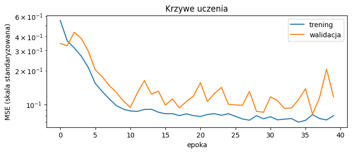
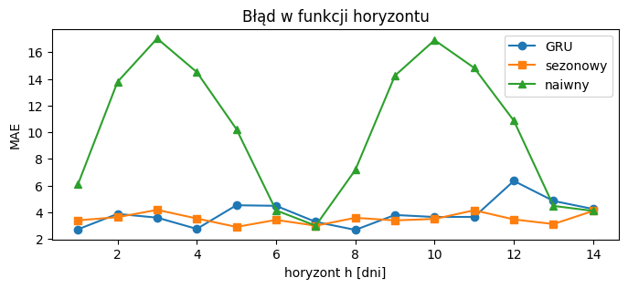

# Sprawozdanie laboratoryjne

**Przedmiot:** Uczenie głębokie w systemach rozpoznawania i przetwarzania mowy
**Zajęcia nr / temat:** 3 — Prognozowanie szeregów czasowych: prognoza wielokrokowa i porównanie z baseline'ami
**Autor / grupa:** Jakub Powroźnik / Gr 5.03 
**Data:** 03.11.2026

## 1. Cel ćwiczenia

Celem ćwiczenia jest sprawdzenie, czy model GRU wnosi coś ponad proste reguły (baseline'y) w prognozie jedno- i wielokrokowej szeregu czasowego, przy uczciwej walidacji czasowej. Zakres obejmuje: ocenę krzywych uczenia, ocenę 14-dniowej prognozy rekurencyjnej na zbiorze testowym, badanie wpływu długości okna wejściowego (3, 7 i 28 dni) oraz interpretację wyników w odniesieniu do modeli mowy.

## 2. Metoda i implementacja

**Narzędzia:** Python, PyTorch, NumPy, Matplotlib.

**Dane:** syntetyczny szereg dziennej sprzedaży (1000 dni) o wzorze: 100 + 0,02·t + 8·sin(2πt/7) + 15·sin(2πt/365) + szum N(0, 3²). Szum ma odchylenie 3, więc teoretyczna granica błędu to MAE ≈ 2,39 i RMSE = 3,00.

**Podział chronologiczny:** trening dni 0–699, walidacja 700–849, test 850–999. Dni nie są tasowane.

**Standaryzacja:** średnia i odchylenie standardowe liczone wyłącznie z części treningowej ((mu = 106,96, sd = 12,00)) i stosowane do całego szeregu, aby uniknąć przecieku danych. Wszystkie metryki liczone są w oryginalnej skali (`pred * sd + mu`).

**Model:** `nn.GRU(1, 32)` + `nn.Linear(32, 1)` (stan ukryty po całym oknie → prognoza), 3393 parametrów. Uczenie: Adam (lr = 1e-2), funkcja straty MSE, batch 64, 40 epok, early stopping (po treningu przywracane są wagi z epoki o najniższej stracie walidacyjnej). Okno domyślne: 28 dni, ziarno 0.

**Prognoza wielokrokowa:** strategia rekurencyjna (prognoza trafia do okna i służy do przewidzenia kolejnego dnia), H = 14, 10 punktów startu co 14 dni w zbiorze testowym.

**Baseline'y** (liczone na tych samych dniach i tym samym horyzoncie): naiwny (ostatnia znana wartość y[t0−1] powtórzona 14 dni), sezonowy (powtórzenie ostatniego znanego tygodnia, y[t0−7+(h mod 7)]) oraz, tylko jednokrokowo, średnia ruchoma.

**Eksperyment z oknem:** OKNO ∈ {3, 7, 28}, każdy wariant na 2 ziarnach (`torch.manual_seed(0)` i `(1)`), model trenowany od zera. Najlepsze okno wybierane według straty walidacyjnej, nie testowej.

## 3. Wyniki

### 3.1 Krzywe uczenia

Najlepsza epoka: **36** (numeracja od 0), val MSE = **0,0822**.

### 3.2 GRU a baseline'y (zbiór testowy)

| metoda | MAE 1-krok | RMSE 1-krok | MAE 14-krok | RMSE 14-krok |
|---|---|---|---|---|
| GRU | 2,91 | 3,54 | 3,88 | 4,75 |
| sezonowy | 3,21 | 4,07 | 3,52 | 4,42 |
| naiwny | 5,44 | 6,51 | 10,09 | 11,85 |
| średnia ruchoma | 5,80 | 6,84 | – | – |
| granica szumu | 2,39 | 3,00 | – | – |

### 3.3 Wpływ długości okna

| okno | ziarno | val MSE | MAE 1-krok | MAE 14-krok |
|---|---|---|---|---|
| 3 | 0 | 0,2567 | 5,00 | 7,18 |
| 3 | 1 | 0,2486 | 5,04 | 7,41 |
| 7 | 0 | 0,0855 | 2,90 | 4,21 |
| 7 | 1 | 0,0896 | 2,88 | 3,89 |
| 28 | 0 | 0,0822 | 2,91 | 3,88 |
| 28 | 1 | 0,0850 | 3,01 | 4,29 |

Średnie z dwóch ziaren i rozrzut (różnica między ziarnami):

| okno | średni val MSE | średni MAE 1-krok (rozrzut) | średni MAE 14-krok (rozrzut) |
|---|---|---|---|
| 3 | 0,2527 | 5,02 (0,04) | 7,30 (0,23) |
| 7 | 0,0876 | 2,89 (0,02) | 4,05 (0,32) |
| 28 | 0,0836 | 2,96 (0,10) | 4,09 (0,41) |

Najlepsze okno według walidacji: **28**.

## 4. Analiza i interpretacja

### 4.1 Krzywe uczenia

Strata treningowa spada szybko do ok. epoki 10, a następnie stabilizuje się na poziomie ok. 0,07–0,09. Strata walidacyjna jest wyższa i silnie waha się między epokami (skoki m.in. w epokach 12, 20, 35 i 38), ale nie rośnie systematycznie, więc nie widać wyraźnego przeuczenia. Niedouczenia również nie widać, ponieważ krzywa treningowa jest płaska, a nie wciąż gwałtownie opada. Wahania walidacji wynikają z dość dużego kroku uczenia (lr = 1e-2), niewielkiej liczby aktualizacji wag na epokę (11) oraz małego zbioru walidacyjnego (150 dni). Najlepsza epoka (36) leży blisko końca treningu, a ostatnia epoka (39) jest wyraźnie gorsza, więc early stopping ma tu realne znaczenie.

### 4.2 GRU a baseline'y

W prognozie jednokrokowej GRU (MAE 2,91, RMSE 3,54) bije baseline sezonowy (3,21 / 4,07) oraz naiwny (5,44 / 6,51). Baseline naiwny i średnia ruchoma ignorują rytm tygodniowy, a sezonowy kopiuje jeden dzień razem z jego szumem, natomiast GRU uśrednia informację z wielu tygodni.

W prognozie 14-dniowej GRU nadal bije naiwny (3,88 vs 10,09), ale przegrywa z baseline'em sezonowym (3,88 vs 3,52; RMSE 4,75 vs 4,42). Przyczyną jest kumulacja błędu w strategii rekurencyjnej. W prognozie jednokrokowej model dostaje za każdym razem prawdziwe obserwacje. W wielokrokowej od drugiego kroku opiera się na własnych prognozach obarczonych błędem, które trafiają do okna. Baseline sezonowy nie kumuluje błędu, bo zawsze kopiuje prawdziwy tydzień sprzed punktu startu.

Wykres MAE w funkcji horyzontu pokazuje, że:
- błąd baseline'u naiwnego **oscyluje z okresem 7 dni**, a nie rośnie monotonicznie: szczyty (ok. 17) przy h = 3 i h = 10, minima (ok. 3–4) przy h = 7 i h = 14. Naiwny powtarza y[t0−1], więc jego błąd zależy od fazy cyklu tygodniowego;
- błąd baseline'u sezonowego jest w przybliżeniu stały (ok. 3–4,2);
- GRU jest najlepszy na pierwszym kroku (ok. 2,7 wobec ok. 3,4 dla sezonowego), ale dla dalszych horyzontów jego błąd jest niestabilny i miejscami wyższy niż sezonowego (ok. 4,5 przy h = 5 i 6, ok. 6,4 przy h = 12).

### 4.3 Granica szumu

Granica szumu dla σ = 3 wynosi MAE ≈ 2,39 (σ·√(2/π)) i RMSE = 3,00. Wynik jednokrokowy GRU (MAE 2,91, RMSE 3,54) jest od niej oddalony o ok. 0,5, więc model jest blisko możliwego optimum. Pozostały błąd to w większości nieusuwalny szum.

### 4.4 Wpływ długości okna

Okno 3 dni jest krótsze niż okres sezonowości tygodniowej (7 dni), więc model nie widzi pełnego cyklu i nie wie, w której fazie tygodnia się znajduje. Zostaje mu poziom i trend, dlatego jego MAE jednokrokowe (ok. 5,0) jest zbliżone do baseline'u naiwnego (5,44), a val MSE jest ok. trzykrotnie większe (ok. 0,25 wobec ok. 0,085). Okna 7 i 28 dają praktycznie ten sam wynik (średnie MAE jednokrokowe 2,89 i 2,96), więc wydłużanie okna ponad okres sezonowości niczego nie poprawia, a tylko wydłuża przetwarzaną sekwencję.

Różnica między oknem 3 a oknami 7 i 28 (ok. 2,1 MAE jednokrokowo) jest znacznie większa niż rozrzut między ziarnami (0,02–0,10), więc jest to realny efekt. Różnica między oknami 7 i 28 (0,07 jednokrokowo) mieści się w rozrzucie ziaren, więc nie można stwierdzić, że któreś jest lepsze. Podobnie jest dla straty walidacyjnej: różnica średnich (0,0876 vs 0,0836) jest porównywalna z rozrzutem między ziarnami w obrębie jednego okna (0,003–0,004). Wybór okna 28 według walidacji jest więc formalnie poprawny, ale wynik nie jest rozstrzygający. W MAE 14-krokowym rozrzut między ziarnami (0,23–0,41) jest większy niż różnica między oknami 7 i 28 (0,04), co wynika z kumulacji błędu: drobne różnice wag są wzmacniane w każdym kroku rekurencji.

### 4.5 Odniesienie do modeli mowy

**Dobór okna** odpowiada doborowi kontekstu w ramkach cech mowy. Okno musi obejmować istotną jednostkę: w sprzedaży okres sezonowości (7 dni), w mowie głoskę (ok. 50–150 ms) lub wyraz. Zbyt krótki kontekst pogarsza wynik, tak jak okno 3 w tym ćwiczeniu.

**Kumulacja błędu** w prognozie rekurencyjnej przenosi się na dekodowanie autoregresyjne w syntezie mowy i modelach seq2seq (Tacotron, dekoder Whispera, WaveRNN). Błąd jednego kroku wpływa na kolejne, więc jakość spada wraz z długością generowanego fragmentu. WaveRNN wykonuje dosłownie prognozę jednokrokową kolejnej próbki sygnału.

**Uczciwa walidacja** też ma odpowiedniki: standaryzacja ze statystykami z treningu odpowiada normalizacji cech (CMVN), a podział chronologiczny odpowiada podziałowi rozłącznemu po mówcach i nagraniach, tak aby ten sam głos nie trafił jednocześnie do treningu i testu.

### 4.6 Ograniczenia

Dane są syntetyczne (znamy ich wzór), prognoza wielokrokowa oceniana jest tylko na 10 punktach startu, a każdy wariant okna na 2 ziarnach, więc różnice rzędu 0,1 MAE nie są rozstrzygające. Krzywa błędu od horyzontu jest zaszumiona i nie pozwala precyzyjnie ocenić tempa narastania błędu.

## 5. Wnioski

- GRU bije oba główne baseline'y w prognozie jednokrokowej (MAE 2,91 wobec 3,21 i 5,44) i jest blisko granicy szumu (2,39).
- W prognozie 14-dniowej GRU przegrywa z baseline'em sezonowym (MAE 3,88 wobec 3,52) z powodu kumulacji błędu w strategii rekurencyjnej, natomiast wyraźnie bije baseline naiwny (10,09).
- Okno wejściowe musi obejmować co najmniej jeden okres sezonowości: okno 3 dni jest wyraźnie gorsze, a okna 7 i 28 dni nie różnią się istotnie. Według walidacji wybrano okno 28.
- **Kierunki poprawy:** zastąpienie strategii rekurencyjnej modelem multi-output (H wyjść naraz) lub direct, zmniejszenie lr lub użycie `clip=1.0`, więcej ziaren i punktów startu dla wiarygodniejszych porównań oraz wykonanie ćwiczenia na rzeczywistym szeregu (wariant rozszerzony).
