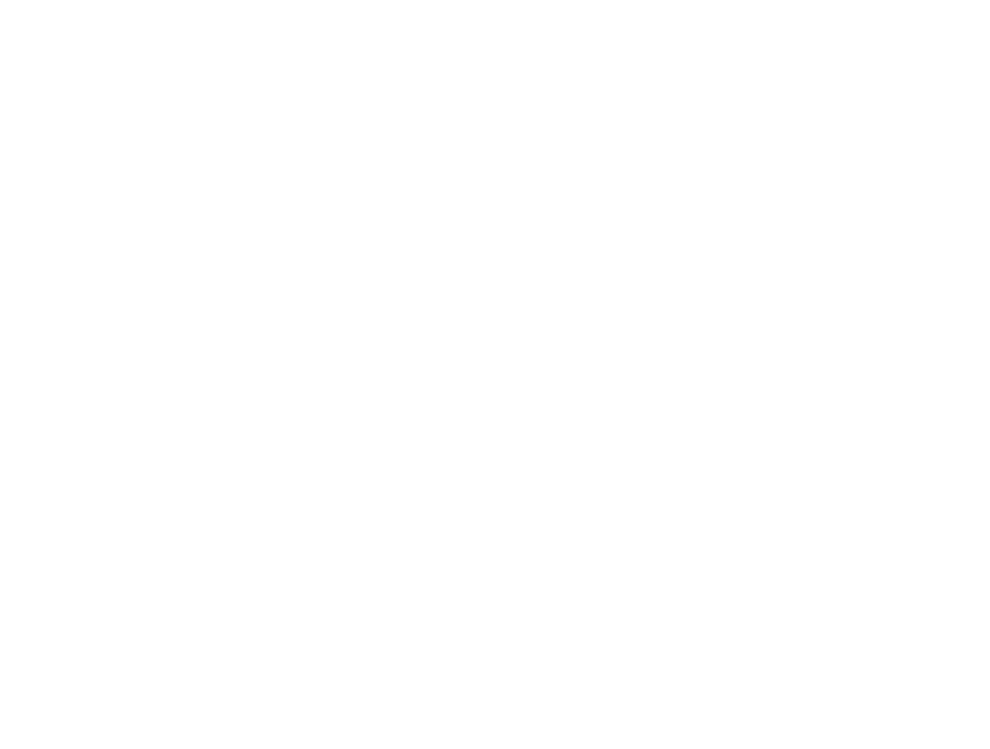

# Sprawozdanie laboratoryjne — laboratorium 4

**Przedmiot:** Uczenie głębokie w systemach rozpoznawania i przetwarzania mowy  
**Zajęcia nr / temat:** 4 / Obsługa długich sekwencji z użyciem SimpleRNN, LSTM, GRU i Conv1D  
**Autor / grupa:** Jakub Powroźnik Gr. Lab 5.03
**Data:** 13.11.2026

## 1. Cel ćwiczenia

Celem było porównanie czterech architektur w zadaniu sumowania wartości wskazywanych przez opóźnione znaczniki. Porównano wyniki dla sekwencji długości 50 i 100. Dla długości 100 sprawdzono też wpływ zwiększenia stanu ukrytego SimpleRNN oraz zmiany dylatacji w Conv1D.

## 2. Metoda i implementacja

Eksperyment wykonano w Pythonie z użyciem PyTorch, NumPy, pandas i Matplotlib. Kod, wyniki i wykres znajdują się w notatniku [lab4.ipynb](lab4.ipynb).

Każda sekwencja ma dwa kanały. Pierwszy zawiera niezależne wartości losowane jednostajnie z przedziału od 0 do 1. W drugim są dwa znaczniki równe 1, wylosowane bez zwracania spośród kroków od 9 do $L$. Pozostałe pozycje zawierają zera. Znacznik w kroku $t$ wskazuje wartość z kroku $t-8$. Cel to suma dwóch wskazanych wartości. W generatorze odpowiada za to instrukcja `Y[i, 0] = X[i, p - 8, 0].sum()`, gdzie `p` zawiera indeksy znaczników liczone od zera.

W przykładzie kontrolnym znacznik w kroku **13** wskazał krok **5** (0,423655), a znacznik w kroku **18** wskazał krok **10** (0,383442). Suma wartości przed zaokrągleniem wyniosła w przybliżeniu **0,807096**, zgodnie z celem zapisanym przez generator.

SimpleRNN, LSTM i GRU w podstawowych wariantach miały stan ukryty o rozmiarze 32. Warstwa liniowa przewidywała sumę na podstawie ostatniego stanu ukrytego. Conv1D miał trzy warstwy po 32 kanały, jądro długości 3, krok 1, aktywacje ReLU i dylatacje `[1, 2, 4]`. Symetryczne dopełnienie równe dylatacji zachowywało długość sekwencji. Przed warstwą liniową cechy uśredniano po czasie.

| Ustawienie | Wartość |
|---|---|
| Długości sekwencji | 50 i 100 |
| Przykłady dla każdej długości | 4000 treningowych, 800 testowych |
| Ziarno losowania NumPy i PyTorch | 0 |
| Urządzenie | CPU |
| Liczba epok / rozmiar partii | 30 / 128 |
| Optymalizator / współczynnik uczenia | Adam / 0,005 |
| Funkcja straty | MSE |
| Maksymalna norma gradientu | 1,0 |

Dla każdej długości wygenerowano raz osobny zbiór treningowy i testowy, wspólny dla wszystkich jej wariantów. Czas w sekundach obejmuje pętlę uczenia. MSE obliczono po treningu na zbiorze testowym. Predykcja stała dla danej długości była równa średniej wartości celu w zbiorze treningowym.

## 3. Wyniki

| $L$ | Model | Test MSE | Czas uczenia [s] | Parametry |
|---:|---|---:|---:|---:|
| 50 | Predykcja stała | 0,16064 | — | — |
| 50 | SimpleRNN | 0,16166 | 2,39 | 1185 |
| 50 | LSTM | 0,16095 | 6,92 | 4641 |
| 50 | GRU | **0,14852** | 5,85 | 3489 |
| 50 | Conv1D `[1, 2, 4]` | 0,15364 | 16,52 | 6465 |
| 100 | Predykcja stała | 0,16734 | — | — |
| 100 | SimpleRNN | 0,16916 | 4,51 | 1185 |
| 100 | LSTM | 0,16934 | 13,82 | 4641 |
| 100 | GRU | **0,16647** | 11,56 | 3489 |
| 100 | Conv1D `[1, 2, 4]` | 0,17110 | 21,79 | 6465 |
| 100 | SimpleRNN, stan 64 | 0,16881 | 5,86 | 4417 |
| 100 | Conv1D `[1, 1, 1]` | 0,17134 | 19,31 | 6465 |

## 4. Analiza i interpretacja

### Wpływ długości sekwencji

Przy $L=50$ GRU uzyskał MSE niższe od predykcji stałej o 0,01212, a Conv1D o 0,00700. SimpleRNN i LSTM miały wyniki zbliżone do predykcji stałej i nieco wyższe od niej.

Po zwiększeniu $L$ z 50 do 100 MSE wzrosło we wszystkich czterech modelach. Wzrost wyniósł 0,00750 dla SimpleRNN, 0,00839 dla LSTM, 0,01795 dla GRU i 0,01746 dla Conv1D. MSE predykcji stałej również wzrosło o 0,00670, ponieważ obie długości oceniano na osobno wylosowanych zbiorach. Przy $L=100$ tylko GRU uzyskał wynik poniżej predykcji stałej, z różnicą 0,00087. Hipoteza o lepszym zachowaniu informacji w modelach z bramkami znalazła częściowe potwierdzenie. GRU miał najniższe MSE przy obu długościach, a LSTM pozostał blisko SimpleRNN.

### Wpływ rozmiaru stanu i dylatacji

Zwiększenie stanu SimpleRNN z 32 do 64 obniżyło MSE o 0,00035, przy wzroście liczby parametrów z 1185 do 4417 i czasu treningu z 4,51 do 5,86 s. MSE większego wariantu nadal przekraczało MSE predykcji stałej o 0,00147.

Pole recepcyjne jednej pozycji mapy cech w Conv1D wynosi $R=1+2(d_1+d_2+d_3)$ przy jądrze długości 3 i kroku 1. Dylatacje `[1, 2, 4]` dają pole 15 kroków, a `[1, 1, 1]` pole 7 kroków. Znacznik i wskazywana wartość są oddalone o 8 kroków, więc objęcie obu przez jedną pozycję mapy cech wymaga co najmniej 9 kolejnych pozycji wejścia. Warunek spełnia wariant z polem 15.

Wariant z polem 15 osiągnął MSE niższe o 0,00024 od wariantu z polem 7. Obie wersje miały po 6465 parametrów. Trening z większym polem trwał w tym pomiarze o 2,48 s dłużej. Oba wyniki MSE przy $L=100$ były powyżej predykcji stałej, więc możliwość lokalnego połączenia znacznika i wartości nie wystarczyła do uzyskania przewagi w tej konfiguracji.

### Przykład z dużym błędem

Dla SimpleRNN ze stanem 32 przy $L=100$ przykład o największym błędzie miał następujące pary pozycji:

| Krok znacznika | Krok wskazywanej wartości | Wartość |
|---:|---:|---:|
| 21 | 13 | 0,036054 |
| 99 | 91 | 0,010872 |

Prawidłowa suma wynosiła **0,046926**, a model przewidział **1,102305**. Błąd kwadratowy wyniósł **1,113825**. Odczyt nastąpił w kroku 100, czyli jeden krok po ostatnim znaczniku i 79 kroków po pierwszym. SimpleRNN musi zachować informację o pierwszej wskazanej wartości w stanie aż do końca sekwencji. Musi też powiązać drugi znacznik z wartością widzianą osiem kroków wcześniej. Duży błąd pokazuje, że w tym przykładzie stan końcowy nie pozwolił poprawnie przewidzieć sumy. Z samej predykcji nie da się ustalić, która z tych zależności sprawiła modelowi trudność.

## 5. Wnioski

GRU uzyskał najniższe MSE dla obu długości, ale przy $L=100$ jego przewaga nad predykcją stałą była niewielka. Conv1D poprawił wynik względem predykcji stałej przy $L=50$. Przy $L=100$ większe pole recepcyjne i większy stan SimpleRNN przyniosły niewielkie spadki błędu względem odpowiednich wariantów porównawczych.

Wyniki pochodzą z jednego ziarna losowania. Powtórzenie treningów dla kilku ziaren pozwoliłoby sprawdzić, czy niewielkie różnice MSE oraz zmierzone różnice czasu są powtarzalne.
