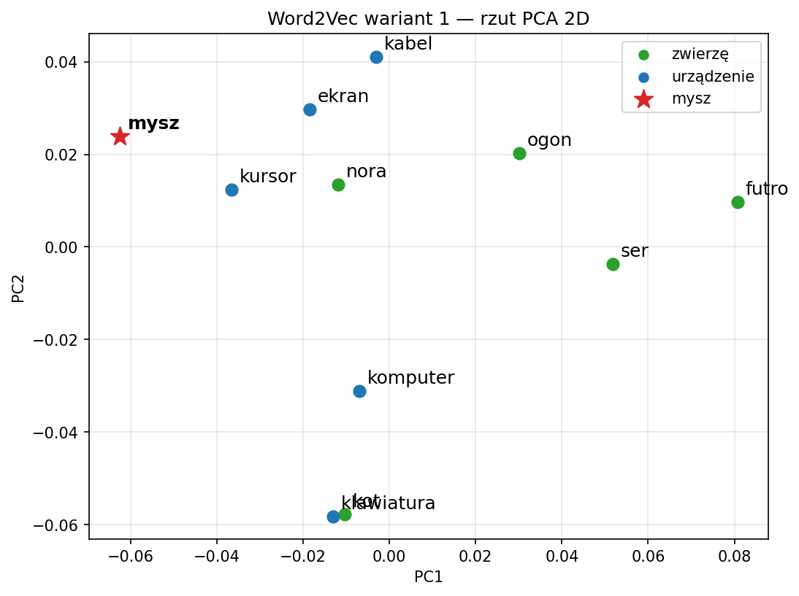

# Sprawozdanie laboratoryjne

**Przedmiot:** Uczenie głębokie w systemach rozpoznawania i przetwarzania mowy
**Zajęcia nr / temat:** 5 — Wprowadzenie do NLP: wpływ korpusu na tokenizację BPE i embeddingi Word2Vec
**Autor / grupa:** Jakub Powroźnik Grupa Lab 5.03
**Data:** 13.11.2026

## 1. Cel ćwiczenia

Na własnym, małym polskim korpusie (60 zdań) zbadałem:

1. jak limit słownika BPE (`vocab_size`) wpływa na podział form fleksyjnych widzianych i niewidzianych w treningu,
2. jak zmiana proporcji kontekstów wyrazu wieloznacznego **„mysz”** (zwierzę / urządzenie) zmienia jego najbliższych sąsiadów w Word2Vec,
3. czy w embeddingach widać grupy tematyczne (rzut PCA oraz średnie podobieństwo cosinusowe).

## 2. Metoda i implementacja

**Narzędzia:** Python, `tokenizers` (BPE), `gensim` (Word2Vec), `scikit-learn` (PCA), `matplotlib`, `pandas`.

### 2.1 Korpus

Zdania napisane na potrzeby ćwiczenia. Trzy pule po 20 zdań:

| Pula | Opis | Liczba zdań | Wystąpień „mysz” |
|---|---|---|---|
| A | mysz = zwierzę | 20 | 20 (raz w każdym zdaniu) |
| B | mysz = urządzenie | 20 | 20 (raz w każdym zdaniu) |
| C | bez słowa „mysz” (zdania neutralne + kilka z wyrazami tematycznymi) | 20 | 0 |

Łącznie 60 unikalnych zdań i 331 różnych wyrazów. Wyrazy charakterystyczne dla tematów występują w kilku różnych zdaniach (np. *kot* w 7, *ogon* w 5, *komputer* i *kursor* w kilku zdaniach pul B i C).

**Przygotowanie tekstu:** zamiana na małe litery i wydobycie ciągów znaków `\w+` (bez interpunkcji). Tokenizer BPE ma normalizer `Lowercase` i pretokenizer `Whitespace`, więc obecność pełnych form sprawdzałem po tej samej normalizacji.

### 2.2 Próbka do oceny BPE

Siedem par: forma obecna w korpusie → forma tego samego wyrazu, której w korpusie nie ma (sprawdzone programowo):

`mysz → myszami`, `kot → kotami`, `komputer → komputerami`, `kabel → kablami`, `klawiatura → klawiaturami`, `nora → norami`, `ser → serami`.

### 2.3 BPE

Trzy tokenizery trenowane na całym korpusie (60 zdań), zmieniany tylko `vocab_size` ∈ {100, 300, 700}; reszta: `special_tokens=['[UNK]']`, `min_frequency=1`.

### 2.4 Word2Vec

Dwa warianty tego samego rozmiaru (36 zdań, 16 wystąpień „mysz” w każdym):

**wariant 1:** pula C + 12 zdań A + 4 zdania B,

**wariant 2:** pula C + 4 zdania A + 12 zdań B.

Ustawienia obu modeli: `vector_size=50, window=3, min_count=2, sg=1 (Skip-gram), epochs=100, seed=0, workers=1`, własny `hashfxn` (crc32) dla powtarzalności wyników między uruchomieniami. Liczba epok 100 zamiast 200 z notatnika wzorcowego: przy 200 epokach na tak małym korpusie wszystkie cosinusy wychodziły ≈ 0,98 i ranking nie niósł informacji.

### 2.5 Grupy tematyczne (wybrane przed obejrzeniem wyników)

**zwierzę:** *kot, ser, nora, ogon, futro* — kot poluje na mysz, ser jest jej pokarmem, nora to jej dom, ogon i futro to cechy jej ciała.

**urządzenie:** *komputer, klawiatura, kursor, ekran, kabel* — elementy zestawu komputerowego, z którymi współpracuje mysz.

W wariancie 1 każde z tych słów ma ≥ 3 wystąpienia (przy `min_count=2`): kot 5, ogon 4, pozostałe 3.

## 3. Wyniki

### 3.1 BPE — średnia liczba tokenów na słowo (7 form w każdej grupie)

| Ustawiony limit | Faktyczny rozmiar | Formy widziane: śr. tokenów | Formy widziane z `[UNK]` | Formy niewidziane: śr. tokenów | Formy niewidziane z `[UNK]` |
|---|---|---|---|---|---|
| 100 | 100 | 2,86 | 0 | 4,43 | 0 |
| 300 | 300 | 1,00 | 0 | 3,00 | 0 |
| 700 | 700 | 1,00 | 0 | 2,71 | 0 |

(Przy limitach ≥ ok. 900 słownik przestaje rosnąć — dla limitu 1000 i 3000 wyszło 896 wpisów — więc 700 to jeszcze nie nasycenie.)

**Podziały dwóch niewidzianych form:**

| Forma | limit 100 | limit 300 | limit 700 |
|---|---|---|---|
| komputerami | ko \| m \| p \| ut \| e \| ra \| mi | komput \| e \| ra \| mi | komput \| e \| rami |
| klawiaturami | k \| la \| wia \| t \| u \| ra \| mi | klawiatura \| mi | klawiatura \| mi |

Pozostałe niewidziane formy: *myszami* i *kotami* → `mysz|a|mi`, `kot|a|mi` przy wszystkich trzech limitach; *norami* → `no|ra|mi` (100), `nora|mi` (300, 700); *kablami* → `ka|b|la|mi` (100), `ka|bla|mi` (300, 700); *serami* → `s|e|ra|mi` (100, 300), `s|e|rami` (700).

### 3.2 Word2Vec — 5 najbliższych sąsiadów słowa „mysz” (cosinus)

| # | Wariant 1 (12 zwierzę / 4 urządzenie) | Wariant 2 (4 zwierzę / 12 urządzenie) |
|---|---|---|
| 1 | kursor (0,65) | kabel (0,62) |
| 2 | a (0,63) | po (0,58) |
| 3 | nora (0,63) | obok (0,56) |
| 4 | i (0,58) | i (0,53) |
| 5 | ekran (0,57) | komputer (0,52) |

Rozmiar słownika: 32 słowa (model 1) i 33 słowa (model 2). Słowa, które wypadły z top‑5 modelu 1, nadal mają wektor w modelu 2:

| Słowo | Liczność w W1 / W2 | cos(mysz, słowo) w modelu 2 |
|---|---|---|
| kursor | 3 / 3 | 0,36 |
| a | 8 / 6 | 0,46 |
| nora | 3 / 2 | 0,10 |
| ekran | 3 / 4 | 0,46 |

Słowa występujące tylko w jednym modelu: tylko w modelu 1 — *cicho, jego, przed, **ser***; tylko w modelu 2 — *bo, nową, roku, ruch, usb*. Słowo *ser* (z grupy „zwierzę”) wypadło ze słownika modelu 2, bo ma tam tylko 1 wystąpienie (< `min_count`).

**Stabilność względem ziarna** (te same ustawienia, seed 0–4), top‑5 sąsiadów „mysz”:

| seed | Wariant 1 | Wariant 2 |
|---|---|---|
| 0 | kursor, a, nora, i, ekran | kabel, po, obok, i, komputer |
| 1 | na, ogon, i, komputer, a | a, biurku, i, na, obok |
| 2 | klawiatura, i, kursor, komputer, kot | ekran, kursor, stoi, bo, i |
| 3 | i, ma, kabel, na, się | i, a, klawiatura, kabel, biurku |
| 4 | a, się, i, kursor, obok | i, a, ogon, się, jest |

### 3.3 Grupy tematyczne — PCA i cosinus

Rzut PCA do 2 wymiarów dla modelu z wariantu 1 (PC1 + PC2 tłumaczą 22,6% + 16,3% = 38,9% wariancji):

Średnie podobieństwo cosinusowe na pełnych 50‑wymiarowych wektorach (tylko słowa z grup, każda para raz):

| Zestaw par | Liczba par | Średni cosinus |
|---|---|---|
| wewnątrz grupy „zwierzę” | 10 | 0,178 |
| wewnątrz grupy „urządzenie” | 10 | 0,436 |
| między grupami | 25 | 0,282 |

Wybrane pary: klawiatura–kursor 0,407; komputer–ekran 0,480; kot–ogon 0,201; ser–futro 0,051; kot–kabel 0,302.

## 4. Analiza i interpretacja

### 4.1 BPE

**Hipoteza (sformułowana przed analizą):** zwiększenie limitu słownika zmniejszy średnią liczbę tokenów dla obu grup; formy widziane w treningu dojdą do ok. 1 tokenu na słowo (całe słowo stanie się wpisem słownika), natomiast formy niewidziane zatrzymają się powyżej 1, bo ich pełnej postaci nie ma w treningu i zostanie rozłożona na temat i końcówkę lub kilka fragmentów. Zakładałem też brak `[UNK]`, bo wszystkie litery tych form występują w korpusie.

**Ocena:** wyniki wspierają hipotezę, z dwiema uwagami.

- Formy widziane osiągają 1,00 już przy limicie 300 — zwiększenie do 700 nic nie zmienia, więc korzyść ze słownika dla form znanych szybko się nasyca. Dla niewidzianych średnia spada wolniej (4,43 → 3,00 → 2,71) i nie schodzi do 1.
- Zmiany między limitami dotyczą konkretnych fragmentów. Dla *komputerami* z 100 do 300 powstaje token `komput` (bo w treningu jest forma *komputer*) i scala się `ko|m|p|ut|e|ra|mi`; z 300 do 700 `ra|mi` zlewa się w `rami` (fragment występuje m.in. w treningowym *rowerami*; trafienie także w *programista* jest tylko przypadkowym podciągiem, nie morfemem). Dla *klawiaturami* przy 300 cała podstawa `klawiatura` staje się jednym tokenem, bo to pełna forma treningowa, i zostaje tylko końcówka `mi` (obecna m.in. w *kolegami, dokumentami, jabłkami*). Dla *serami* dopiero przy 700 pojawia się `rami`; nigdy nie wydziela się `ser`+końcówka, bo reguła `r+a` jest wcześniejsza niż `e+r` i fragment `ra` powstaje, zanim zdąży powstać `er`/`ser` (stąd `s|e|ra|mi`).
- Nie wszystkie niewidziane formy są „czysto” dzielone na temat + końcówkę: *myszami → mysz|a|mi* (końcówka -ami rozpada się na `a`+`mi`), a *komputerami → komput|e|ra|mi* dzieli temat w środku. Granice tokenów nie pokrywają się z granicami morfemów.
- `[UNK]` nie wystąpił ani razu, zgodnie z oczekiwaniem (wszystkie litery tych form występują w korpusie).

Ograniczenia: 7 par, jeden korpus 60 zdań, brak powtórzeń; wynik 1,00 dotyczy tej próbki i nie przenosi się na nowy tekst.

### 4.2 Word2Vec — sąsiedzi słowa „mysz”

Ranking zmienił się: w wariancie 1 na czele jest *kursor*, *nora*, *ekran*, w wariancie 2 — *kabel*, *komputer*; wspólne są tylko słowa funkcyjne *i* (i częściowo *a*). Z top‑5 wariantu 1 wypadły *kursor, a, nora, ekran* i wszystkie nadal mają wektor w modelu 2 (liczności 3/3, 8/6, 3/2, 3/4), więc to nie brak słowa w słowniku, tylko zmiana pozycji w rankingu. Spadek *nora* (cos 0,63 → 0,10) zgadza się z kontekstem: w wariancie 1 są dwa zdania z norą i myszą („**Nora** jest ciasna i ciemna, ale **mysz** czuje się w niej bezpiecznie.”, „**Nora** ma kilka wyjść, więc **mysz** łatwo ucieka przed drapieżnikiem.”), w wariancie 2 zostaje tylko pierwsze.

Jednocześnie wynik **nie jest zgodny z prostym oczekiwaniem**, że wariant 1 (12 zwierząt) da sąsiadów „zwierzęcych”: dwóch z pięciu sąsiadów to słowa „urządzeniowe” (*kursor, ekran*). Zdanie „Ekran jest czarny, a kursor stoi w miejscu, bo mysz się zawiesiła.” jest w obu wariantach (należy do zdań B użytych w obu), podobnie „Kabel był za krótki, więc mysz ledwo sięgała do krawędzi biurka.”; samo ich obecność nie tłumaczy więc różnicy. *Kabel* wchodzi na 1. miejsce w wariancie 2 dopiero po dodaniu ośmiu kolejnych zdań B, a pojedyncze zdanie z *kabel* nie zmieniło się.

Test z innymi ziarnami pokazuje, że **ranking jest niestabilny**: przy seed 0–4 poza słowami funkcyjnymi (*i, a, na, się*) zmieniają się także słowa tematyczne, a słowa „urządzeniowe” pojawiają się w top‑5 wariantu 1 przy każdym ziarnie, zaś „zwierzęce” (*ogon, kot, nora*) tylko sporadycznie i bez wyraźnej zależności od wariantu (np. *ogon* w wariancie 2 przy seed 4). Przy 16 wystąpieniach „mysz” i 36 zdaniach różnica proporcji 12:4 vs 4:12 jest za słaba, by wyraźnie przesunąć sąsiadów ponad szum losowania. Dodatkowo słowa o liczności 2–3 mają wektory słabo wytrenowane, a częste słowa funkcyjne (*a, i, na, po*) mają podobne konteksty do prawie każdego słowa.

### 4.3 Grupy tematyczne

Na wykresie PCA grupy są **widoczne tylko częściowo**. Słowa „zwierzęce” *ogon, ser, futro* leżą po prawej stronie (PC1 > 0,03), natomiast *nora* i *kot* są wymieszane z słowami „urządzeniowymi” (*kot* niemal nakłada się na *klawiaturę*), a „urządzeniowe” *kursor, ekran, kabel* leżą po lewej/górze, blisko „mysz”. Dwa wymiary tłumaczą tylko 38,9% wariancji, więc wykres nie jest rozstrzygający.

Wartości cosinusa potwierdzają obraz tylko dla jednej grupy: wewnątrz grupy „urządzenie” średnia (0,436) jest wyraźnie większa niż między grupami (0,282), natomiast wewnątrz grupy „zwierzę” (0,178) jest **mniejsza** niż między grupami. Przykład: para *klawiatura–kursor* (0,407) z jednej grupy ma duże podobieństwo — oba słowa występują w tych samych zdaniach pul B/C o komputerze („Ekran jest jasny, a kursor miga…”, „Nowa klawiatura ma ciche przyciski i długi kabel.”) — natomiast *ser–futro* (0,051) z grupy „zwierzę” jest mniej podobne niż *kot–kabel* (0,302) z różnych grup, bo *ser* i *futro* nigdy nie występują w jednym zdaniu ani w podobnych kontekstach (*ser* w kontekście jedzenia, *futro* w opisach ciała). Wniosek: grupa „urządzenie” jest spójna dzięki temu, że jej słowa współwystępują w tych samych zdaniach, a grupa „zwierzę” nie, mimo że łączy je temat. Word2Vec uczy się współwystępowania, a nie „tematu”, więc przypisanie z góry nie musi odpowiadać strukturze wyuczonej na tak małej próbce.

## 5. Wnioski

1. Zwiększenie limitu BPE zmniejsza liczbę tokenów: formy widziane osiągają 1 token/słowo już przy 300 wpisach, formy niewidziane spadają z 4,43 do 2,71 i pozostają rozłożone na kilka fragmentów. Hipoteza potwierdzona na tej próbce; granice tokenów nie pokrywają się z granicami morfemów (*mysz|a|mi*, *komput|e|ra|mi*).
2. Zmiana proporcji znaczeń „mysz” zmieniła ranking sąsiadów, ale zmiana jest niestabilna względem ziarna i nie daje się jednoznacznie przypisać proporcji kontekstów. Na korpusie 36 zdań wnioski o znaczeniu wieloznacznego słowa byłyby nadinterpretacją. Ponadto statyczny wektor łączy oba znaczenia w jeden punkt.
3. Grupy tematyczne widać częściowo: spójna jest grupa „urządzenie” (cos 0,436 vs 0,282 między grupami), grupa „zwierzę” nie (0,178). Powodem jest współwystępowanie słów w zdaniach, a nie sam temat.
4. Ograniczenia: bardzo mały korpus napisany samodzielnie (60 zdań), słowa o liczności 2–3, wynik jednego ziarna w tabelach, PCA 2D tłumaczy tylko 38,9% wariancji. Kierunki poprawy: większy i bardziej zróżnicowany korpus, wielokrotne ziarna z uśrednianiem cosinusów, więcej par form w ocenie BPE, a dla rozróżnienia znaczeń — modele kontekstowe (np. BERT/HerBERT).
